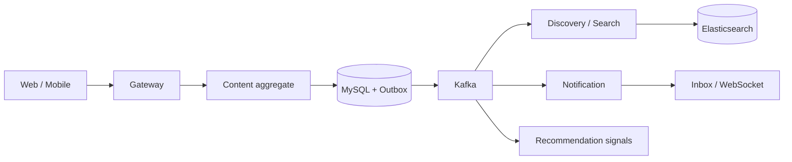

<h1 align="center">MYSTICVERSE</h1>

<p align="center"><strong>面向推理、科幻与宇宙爱好者的主题内容社区，也是一个可运行、可观测、可回滚的 Spring 微服务工程样板。</strong></p>

<p align="center">
  Repository codename: <strong>DevCircle</strong>
</p>

<p align="center">
  <a href="https://github.com/wangyufanshuai/DevCircle/actions/workflows/ci.yml?query=branch%3Aoverhaul%2Fmysticverse-production"></a>
  
  
  
  
  <a href="./LICENSE"></a>
</p>

<p align="center">
  <a href="#-本地运行">快速开始</a>
  ·
  <a href="./docs/architecture.md">架构</a>
  ·
  <a href="./docs/api-examples.http">API 示例</a>
  ·
  <a href="./docs/production-runbook.md">生产手册</a>
</p>


## 这是什么

MysticVerse 是一个围绕“推理馆、科幻馆、宇宙档案”组织内容、解谜和创作的社区产品。用户可以阅读主题内容、参与推理解谜、发布作品、关注作者、搜索与收藏；运营侧可以审核内容、处理风险、管理推荐实验和检查系统健康。

DevCircle 是仓库和工程代号。这个仓库的价值不只是一组页面：它完整展示了内容从发布到审核、搜索、推荐、互动和通知的生产链路，以及这些链路在依赖故障、重复消息和版本切换时如何保持可恢复。

## 产品体验

- **三座主题馆**：推理、科幻、宇宙内容使用独立视觉、分类和推荐语境。
- **推理解谜**：覆盖密室、时间线、证词矛盾、物证误导、密码、列车、航海、剧院和冷案等题型。
- **创作与互动**：发帖、标签、媒体、评论、点赞、收藏、关注关系和个人中心。
- **发现系统**：搜索、相关内容、多路召回、热度与兴趣排序、实验分桶和曝光去重。
- **内容治理**：机审信号、风险等级、审核 SLA、人工复审、用户风险画像和审计日志。
- **运营工作台**：推荐实验、Outbox backlog/replay、数据源状态、告警与服务健康。

首批初始化内容包含 100 条推理、40 条科幻和 40 条宇宙主题数据，用于本地 Demo；生产读请求不会在数据库缺失时静默回退到 seed 数据。

## 为什么这个工程值得看

### 写入链路可追踪

内容发布与 Outbox 事件在同一事务落库。Kafka 采用至少一次投递，消费端通过 `event_id` 去重；同一聚合的事件严格保序，失败前序不会被后续事件越过。



### 部署边界经过收敛

Maven 领域模块与生产 JVM 不是一一对应：

- `dc-identity` 默认承载认证、用户、互动与个人仪表盘；通知默认由独立 `dc-notification` 承载，迁入 Identity 必须通过门禁并显式应用 cutover overlay。
- `dc-content-deployment` 聚合 Content 与 File，同时保留独立 schema、Flyway 历史与逻辑 producer。
- `dc-discovery` 承载 Search 代码模块；`dc-recommend` 保持独立进程与独立实验边界。
- 旧 `dc-auth`、`dc-search`、`dc-content`、`dc-file` 等独立镜像作为明确的一版本 rollback 面保留，不属于默认生产拓扑。

默认服务、端口、资源与运行职责统一见 [生产拓扑](./docs/production-topology.md)。Maven 模块数不等于实际 JVM 数。

### 故障不是一句“最终一致”

- Outbox 有租约、退避、最大尝试、`DEAD` 状态和受控 replay。
- 搜索事件携带内容业务 `aggregateVersion`；数据库水位、ES 更新和重建都只接受更高版本，删除保留版本墓碑。旧无版本事件拒绝消费；升级步骤见 [搜索版本迁移](docs/search-version-migration.md)。
- 评论、点赞等计数带生产者版本，乱序消息不会让计数倒退。
- 同步依赖使用有界连接/读取超时，失败交给错误响应、重试或 DLT，而不是无限占用线程。
- Notification cutover 明确保证 Flyway、consumer、topic admin、API 与 WebSocket 的 exactly-one ownership。

## 技术栈

| 层 | 选型 |
|---|---|
| 后端 | Java 21、Spring Boot 4、Spring Cloud Gateway、Maven |
| 数据 | MySQL 8.4、Redis、Kafka 4.1、Elasticsearch 9、MinIO |
| 前端 | Vue 3、Vite 7、TypeScript、Naive UI、Playwright |
| 可观测 | Micrometer、Prometheus、Alertmanager、Grafana、Jaeger / OTLP |
| 交付 | Docker Compose、Helm、GHCR、固定提交 SHA 镜像 |
| 质量 | JUnit 5、Testcontainers、Playwright、k6、Helm lint |

## ⚡ 本地运行

只有一台电脑时，优先使用核心业务切片（9 个容器，声明内存上限合计 2.0625 GiB）：

```powershell
.\scripts\dev\local.ps1 quick   # 不启动容器的快测
.\scripts\dev\local.ps1 up      # 构建并启动核心链路
.\scripts\dev\local.ps1 verify  # 两轮保留数据的重启、业务反例和资源采样
.\scripts\dev\local.ps1 down    # 停止核心切片，保留数据卷
.\scripts\dev\local.ps1 accept  # 串行完整软件验收；先停止核心切片
```

前置依赖：JDK 21、Node.js、Python 3.10+、Git 和 Docker Compose 2.24.4+。页面入口为 <http://127.0.0.1:5512>。容器上限不包含 Windows、Docker 虚拟机和构建开销；入口会检查主机剩余内存。启动过程中会创建标记为 `local-*` 的合成测试账号和内容。完整说明见 [本机工作流](./docs/local-workflows.md)，反例与验收边界见 [业务不变量](./docs/business-invariants.md)。

### 完整 Demo（资源充足时）

完整 Demo 会启动数据库、消息、搜索、对象存储、可观测组件和应用服务。建议准备 Docker Desktop、JDK 21、Node.js 与至少 16 GB 可用内存。

目前旧 MinIO 官方镜像已无法从公共仓库拉取；以下完整 Demo 命令仍依赖已有镜像缓存。清洁环境的真实集成测试使用 CI 从固定官方源码构建的测试镜像，具体步骤与适用边界见 [CI 验证说明](./docs/ci-verification.md#minio-测试依赖)。完整 Demo / 生产镜像分发的后续迁移尚未完成。

```powershell
git clone --branch overhaul/mysticverse-production https://github.com/wangyufanshuai/DevCircle.git
cd DevCircle
Copy-Item .env.example .env
.\scripts\dev\doctor.ps1
.\scripts\dev\up-infra.ps1
.\scripts\dev\compile-build.ps1
.\scripts\dev\up-demo.ps1 -Build
```

访问：

- MysticVerse：<http://localhost:5501>
- API Gateway：<http://localhost:8080>
- Prometheus：<http://localhost:19090>
- Grafana：<http://localhost:13000>
- Jaeger：<http://localhost:16686>

停止环境：

```powershell
.\scripts\dev\down.ps1
```

如果只想研究后端，可以停在 `up-infra.ps1` 后，从 IDE 分别启动所需模块。完整环境、profile 与常见故障见 [云服务器 Docker 部署](./docs/deployment-cloud-docker.md)。

## 认证与媒体安全

- 邮箱密码与 GitHub OAuth；Demo Token 和 Mock 登录降级已经删除。
- Access Token 只驻留前端内存；Refresh Token 使用 Secure、HttpOnly Cookie。
- Gateway 负责真实 JWT 校验、角色拦截、TraceId、限流与用户上下文透传。
- 公开内容响应只返回媒体元数据；浏览器通过 `/api/files/access` 获取短期读取地址。
- `/internal/**` 不经外部 Gateway 暴露，运维汇总接口使用独立内部密钥。
- 生产 Helm values 要求强随机密钥、Secure Cookie 与非可选 Secret 引用。

前端只需配置入口与通知通道：

```env
VITE_API_BASE_URL=http://localhost:8080
VITE_NOTIFICATION_SOCKET_ENABLED=false
```

安全细节见 [OAuth2 与安全](./docs/oauth2-security.md)。

## 验证

```powershell
.\mvnw.cmd -B test
cd web
npm ci
npm run build
npm run test:e2e
cd ..
helm lint deploy/helm/devcircle -f deploy/helm/devcircle/values-dev.yaml
helm lint deploy/helm/devcircle -f deploy/helm/devcircle/values-prod.yaml --set image.tag=0123456789abcdef0123456789abcdef01234567
docker compose --profile infra config
docker compose --profile demo config
```

CI 对 `main`、`overhaul/mysticverse-production` 推送和 PR 执行验证，也声明了手动入口；只有 `main` 推送允许发布镜像。手动入口的默认分支要求、必需检查与证据查阅见 [CI 验证说明](./docs/ci-verification.md)。本机 `test` 在 Docker 不可用时可能跳过集成测试；完整验收还要求 coverage 和零跳过门禁。

2026-08-15 的历史记录中，Windows Docker Desktop 已验证聚合拓扑的 Testcontainers、内容/社区/搜索 E2E，以及 Kafka/Elasticsearch 恢复切片；这不等价于目标 Linux 的容量、全量恢复、Helm 实际部署或 Cosign Registry 验签。证据边界见 [工程就绪说明](./docs/engineering-readiness.md) 与 [验收报告](./docs/acceptance-report.md)。

## 项目结构

```text
dc-gateway/              统一入口、鉴权、路由、限流与日志
dc-identity/             聚合身份与个人域的生产部署单元
dc-content-deployment/   Content + File 生产部署单元
dc-discovery/            Search / discovery 生产边界
dc-recommend/            独立推荐与实验进程
dc-*/                    领域模块与兼容/回滚镜像
web/                     MysticVerse 前台与运营端
deploy/                  Compose overlay、Helm 与回滚拓扑
scripts/                 开发、验收、运维与发布脚本
docs/                    架构、SLO、安全、实验和运行手册
```

## 文档地图

- [架构说明](./docs/architecture.md) — 服务边界、Outbox、搜索、推荐与数据流。
- [技术规格](./docs/technical-specification.md) — 组件与接口细节。
- [生产运行手册](./docs/production-runbook.md) — 配置、密钥、发布和恢复。
- [可观测运行手册](./docs/observability-runbook.md) — 指标、告警与排障。
- [服务等级目标](./docs/service-level-objectives.md) — SLI/SLO 与错误预算。
- [内容治理](./docs/governance-platform.md) — 审核、风险与运营边界。
- [推荐实验](./docs/recommendation-experiment.md) — 分桶、指标和实验生命周期。
- [性能报告](./docs/performance-report.md) — 压测方法与结果边界。
- [恢复演练](./docs/recovery-rehearsal.md) — 依赖故障和数据恢复。
- [搜索索引迁移与回滚](./docs/search-migration-rehearsal.md) — 本机旧／新程序切换、快照恢复和只读回滚。

## 当前方向

这个项目已经不需要继续拆更多服务。下一阶段更有价值的是：统一 `MysticVerse` 的品牌与仓库元数据；提供只启动核心阅读/解谜链路的 Lite Demo；完成目标 Linux 的真实性能与恢复演练；用真实用户指标验证主题社区是否形成阅读—解谜—创作闭环。

Apache License 2.0，详见 [LICENSE](./LICENSE)。
