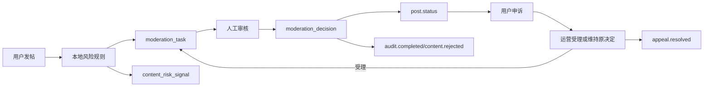

# v1.2 内容治理平台

当前版本将普通审核升级为内容平台治理链路：发帖后进入机审评分、审核队列、人工决策、申诉、风险用户治理和事件补偿。

## 数据模型

- `moderation_task`: 审核任务，记录队列、机审结果、风险等级、风险分、SLA、复审状态。
- `moderation_rule`: 本地规则配置，当前覆盖高频发帖、敏感标签、重复内容、上传异常。
- `moderation_decision`: 人工审核决策，记录通过、驳回、复审、要求修改。
- `content_risk_signal`: 内容或行为风险信号，用于用户画像。
- `appeal_record`: 用户申诉记录。
- `user_risk_profile`: 用户风险状态，支持观察、禁发、封禁等治理状态。

## 业务流

## 管理接口

- `GET /api/admin/moderation/tasks`
- `POST /api/admin/moderation/tasks/{id}/approve`
- `POST /api/admin/moderation/tasks/{id}/reject`
- `POST /api/admin/moderation/tasks/{id}/escalate`
- `POST /api/admin/moderation/tasks/{id}/require-changes`
- `GET /api/admin/appeals?status=PENDING`
- `POST /api/admin/appeals/{id}/approve`
- `POST /api/admin/appeals/{id}/reject`
- `GET /api/admin/risk/users`
- `GET /api/admin/risk/users/{id}/profile`
- `POST /api/admin/risk/users/{id}/restrict`
- `POST /api/admin/risk/users/{id}/unrestrict`

审核、申诉、限制、解限和封禁决定都要求真实管理员身份、理由与 `Idempotency-Key`。用户治理状态只接受 `WATCH`、`RATE_LIMITED`、`NO_POST` 和 `BANNED`；未传限制状态时默认 `NO_POST`。用户风险状态与审计日志在同一事务内提交，审计或数据库写入失败时不得留下部分生效的限制。受理申诉会把投稿重新置为 `PENDING`，创建独立的 `appeal-review` 人工复审任务，并通过 Outbox 通知作者；维持原决定不会改变投稿状态。

## 当前边界

本版使用本地规则模拟机审，不接外部内容安全 API；Gateway 风控拦截通过配置化用户 id 列表占位，后续可替换为实时用户风险服务查询。
