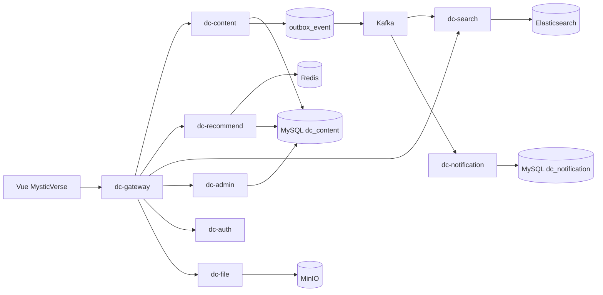

# DevCircle / MysticVerse 技术说明

## 定位

DevCircle 是工程代号，MysticVerse 是前台产品名。v1.2 将项目定位为“生产预备级主题内容平台 + 内容治理/推荐实验 + 工程化运行平台”：围绕推理馆、科幻馆、宇宙档案提供内容发布、详情阅读、解谜积分、推荐、搜索、互动、通知、审核、媒体上传、认证授权、容器交付和可观测能力，并继续补齐审核队列、风险画像、申诉、推荐实验分桶、事件日志、显式降级和运维接口。

项目不承诺直接支撑真实大规模商业流量，但工程结构刻意接近真实后端项目：数据优先落 MySQL，跨服务一致性使用 Outbox + Kafka，搜索同步 Elasticsearch，推荐记录特征与曝光，前端明确展示降级状态。

## 模块边界

| 模块 | 职责 |
| --- | --- |
| `dc-gateway` | 统一入口、TraceId、JWT 校验、角色拦截、用户上下文透传 |
| `dc-auth` | 密码登录、JWT access/refresh、退出、OAuth2 provider 入口、审计日志 |
| `dc-content` | 主题帖子、详情、相关内容、推理解谜、审核状态、Outbox |
| `dc-search` | Kafka 内容事件同步、ES 查询、手动重建索引 |
| `dc-recommend` | 规则/线性模型排序、Redis 热度和曝光、推荐特征日志、实验分桶、多路召回来源 |
| `dc-interaction` | 点赞、收藏、幂等写入、热度信号 |
| `dc-notification` | 通知落库、Kafka 消费、WebSocket 推送 |
| `dc-file` | MinIO 上传、媒体元数据、MIME/扩展名/魔数校验 |
| `dc-admin` | 审核、审计日志、运营概览、治理队列、风险用户、推荐实验管理 |
| `web` | Vue 3 前台和管理演示 |

## 核心链路

## 数据策略

- 开发环境使用一个 MySQL 实例、多个 schema。
- 每个写服务使用 Flyway 管理 schema。
- `ThemeContentLibrary` 只作为首次初始化数据和开发环境显式读取降级来源；生产正常链路只读 MySQL/ES，依赖故障不得伪造成功。
- 写内容时同事务写 `post`、`post_content`、`post_tag`、`post_media`、`outbox_event`。
- 审核通过真实更新 `post.status`，写 `post_audit_record`、`audit_log` 和 `audit.completed` Outbox。
- 发帖后会生成 `moderation_task`，本地规则写入 `content_risk_signal` 和 `user_risk_profile`，高风险内容进入人工队列。
- 用户申诉写入 `appeal_record` 和 `appeal.created` Outbox，便于后续复审补偿。
- 推荐曝光写 Redis，同时写 `recommendation_impression`，便于后续做实验分析。
- 推荐点击、点赞、收藏、答题、详情访问写 `recommend_event_log`，并发布 `recommend.event.logged` 事件。

## 认证与安全

- `dc-auth` 签发 JWT access token 和 refresh token。
- refresh token 哈希后写库，退出时撤销。
- Gateway 解析 JWT 并透传 `X-User-Id`、`X-Roles`、`X-Trace-Id`。
- 管理接口要求 `ADMIN` 角色。
- 本地与生产统一使用邮箱密码或 GitHub OAuth，不提供固定 Token 登录通道。
- 上传校验文件大小、MIME、扩展名和魔数，拒绝脚本类伪装上传。

## 推荐系统

推荐系统保持 Java 本地轻量实现：

- 候选来源：内容服务 MySQL 列表优先；生产依赖失败直接返回错误，开发环境只有显式开启读取降级时才允许 seed fallback。
- 召回来源：主题召回、标签召回、热榜召回、关注作者召回、同系列召回、冷启动召回。
- 实验能力：`recommend_experiment` 与 `recommend_experiment_bucket` 控制实验、分桶、流量比例和权重配置。
- 排序特征：主题匹配、标签兴趣、热度、时效、关注作者、共同关注、曝光惩罚。
- 返回字段：`algorithm`、`features`、`reason`、`degraded`、`source`、`experimentId`、`bucket`、`recallSources`。
- Redis key：`feed:hot-posts`、`user:{id}:interest-tags`、`user:{id}:exposed-posts`、`user:{id}:followees`。

## 内容治理与风控

治理链路保留本地规则，不依赖外部内容安全 API：

- 机审规则识别敏感标签、重复内容、短内容、视频/上传异常和短时间高频发布。
- `moderation_task` 记录队列、机审结果、风险等级、SLA、复审状态和处理人。
- 人工动作包括通过、驳回、要求修改、升级复审。
- `appeal_record` 记录用户申诉，后续可接入复审流程。
- `user_risk_profile` 支持正常、观察、限流、禁发、封禁等状态。
- Gateway 预留用户状态拦截：封禁用户阻断写接口，禁发用户阻断发帖。

## 部署与可观测

- Compose profiles：`infra` 只启动基础设施，`app` 启动应用服务，`demo` 启动全栈。
- Helm values：`values-dev.yaml` 和 `values-prod.yaml` 分离镜像、资源、Ingress 和生产密钥策略；生产不启用 demo token 或 mock fallback。
- CI：后端测试、前端构建、Playwright、Helm lint、Compose config、GHCR 镜像构建、Trivy 扫描。
- 可观测：Actuator + Prometheus + Grafana + Jaeger；告警覆盖服务不可用、5xx、P95、JVM、连接池压力。

## 生产差距

v1.2 是生产预备版，还不是大规模生产系统。后续应继续补：

- 完整多环境 Secret 管理和灰度发布。
- Kafka lag、Outbox backlog、ES 健康等更细指标。
- 推荐实验离线评估、自动报表和审批流。
- OAuth2 设备风控、已认证账号的显式绑定流程和密钥轮换自动化。
- 云服务器或 Kubernetes 的真实压测数据和长期运行报告。
